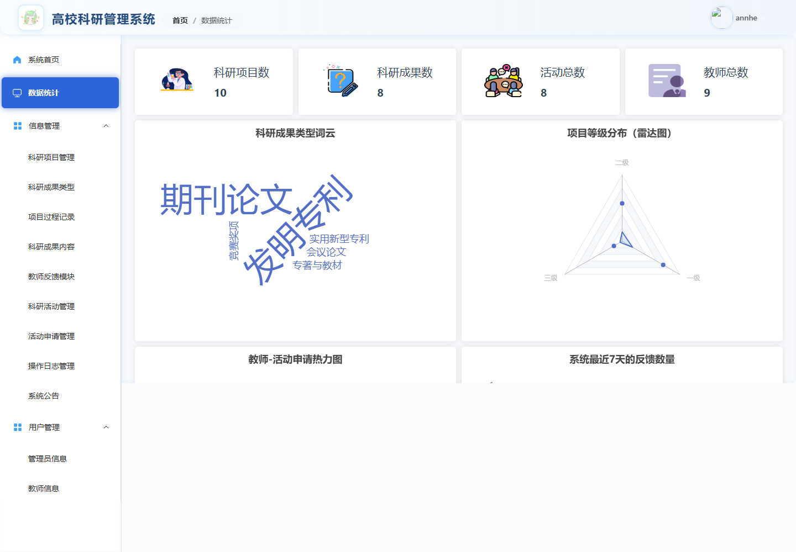
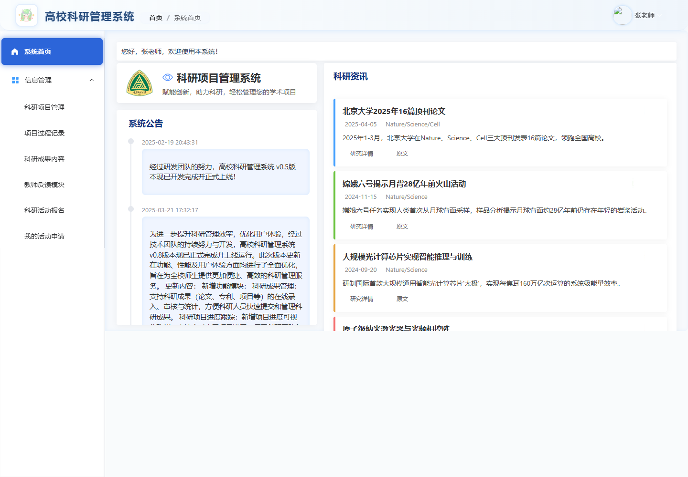
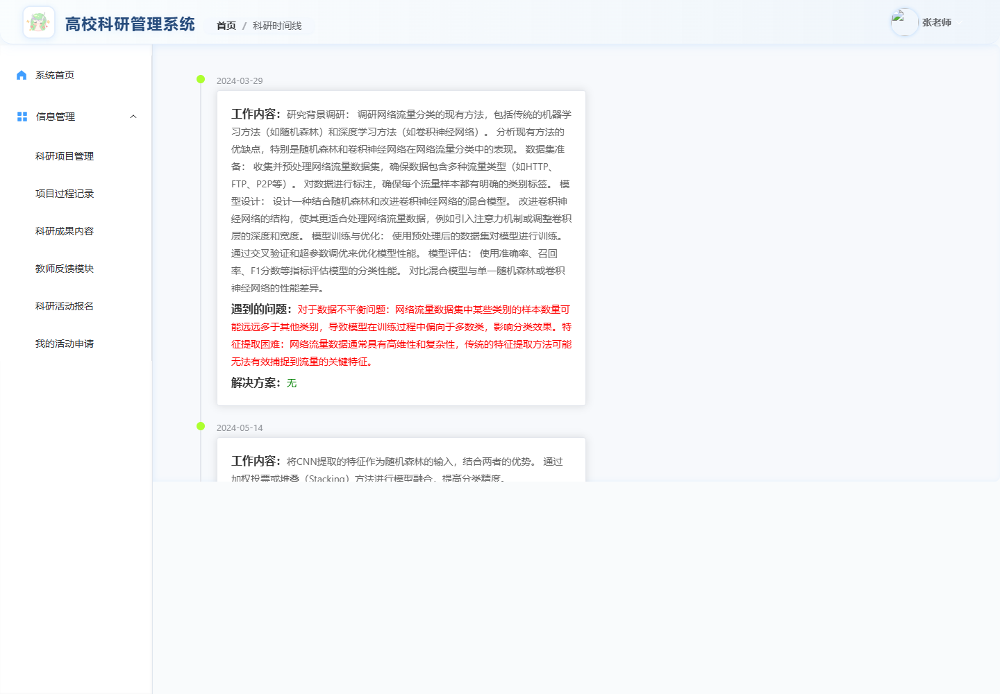

# 科研管理系统 · ScienceManage

基于 **Vue 3 + Spring Boot 3** 的前后端分离科研管理系统，面向管理员和教师，提供科研项目、过程记录、成果归档与学术活动管理等功能。

## 页面截图

以下截图来自本地运行的真实页面。管理员和教师账号均已验证登录，业务截图展示当前数据库中的数据。

### 登录


### 注册


## 业务页面

### 管理员 · 数据统计

汇总科研项目、成果、活动和教师数量，并通过词云、雷达图等图表展示科研数据。



### 教师 · 系统首页

查看系统公告和科研资讯，通过侧边栏进入项目、成果、反馈和活动申请模块。



### 教师 · 科研时间线

按日期展示科研过程中的工作内容、遇到的问题和解决方案。



## 功能

| 模块 | 功能说明 |
| --- | --- |
| 账户与个人中心 | 登录、注册、个人资料维护、密码修改 |
| 人员管理 | 管理员信息、教师信息管理 |
| 科研项目 | 项目信息管理，科研过程记录与科研时间线 |
| 科研成果 | 成果分类维护、科研成果管理 |
| 学术活动 | 活动管理、教师活动页面与我的申请 |
| 沟通与公告 | 系统公告、教师反馈提交和反馈回复 |
| 数据统计 | 数据统计页面，使用 ECharts 展示数据 |
| 系统管理 | 日志管理、文件上传与访问 |

## 技术栈

- 前端：Vue 3、Vite 6、Vue Router 4、Element Plus、Axios、ECharts。
- 后端：Java 17、Spring Boot 3.4.2、MyBatis、PageHelper、JWT、Spring AOP。
- 数据库：MySQL；项目附带 `springboot/system.sql` 数据脚本。

## 项目结构

```text
system/
├── vue/                 # Vue 前端
│   └── src/views/       # 登录、注册及管理端页面
├── springboot/          # Spring Boot 后端
│   ├── src/main/java/   # 接口与业务实现
│   ├── src/main/resources/ # 配置和 MyBatis 映射
│   └── system.sql       # 数据库脚本
├── files/               # 文件资源
└── docs/screenshots/    # README 页面截图
```

## 本地运行

准备 Java 17、Maven、MySQL，以及支持 Vite 6 的 Node.js（可使用 Node.js 22）和 npm。

### 1. 初始化数据库

创建名为 `system` 的 MySQL 数据库，再使用 MySQL 客户端导入 `springboot/system.sql`。导入前检查脚本内容，并使用独立的开发数据库。

修改 `springboot/src/main/resources/application.yaml` 中的数据库连接地址、用户名和密码。后端默认监听 `9090` 端口。

### 2. 启动后端

```bash
cd springboot
mvn spring-boot:run
```

### 3. 启动前端

在另一个终端执行：

```bash
cd vue
npm ci
npm run dev
```

打开 Vite 在终端输出的本地地址。开发环境接口地址在 `vue/.env.development` 中配置，默认连接 `http://localhost:9090`。

### 4. 构建

```bash
# 前端（在 vue 目录）
npm run build

# 后端（在 springboot 目录）
mvn clean package
```

前端部署前检查 `.env.production` 的接口地址；使用浏览器历史路由时，需要配置服务器将前端页面请求回退到 `index.html`。文件访问地址可通过后端的 `fileBaseUrl` 配置调整。

## 说明

功能说明依据仓库中的页面路由、接口与依赖整理。业务页面需要后端和数据库正常运行；已验证管理员和教师登录及本文所示业务页面的数据展示，尚未完成新增、修改、审批等全部业务流程测试。部分账号头像资源未能加载；项目管理页面在本次本地预览中出现白屏，未纳入截图。

