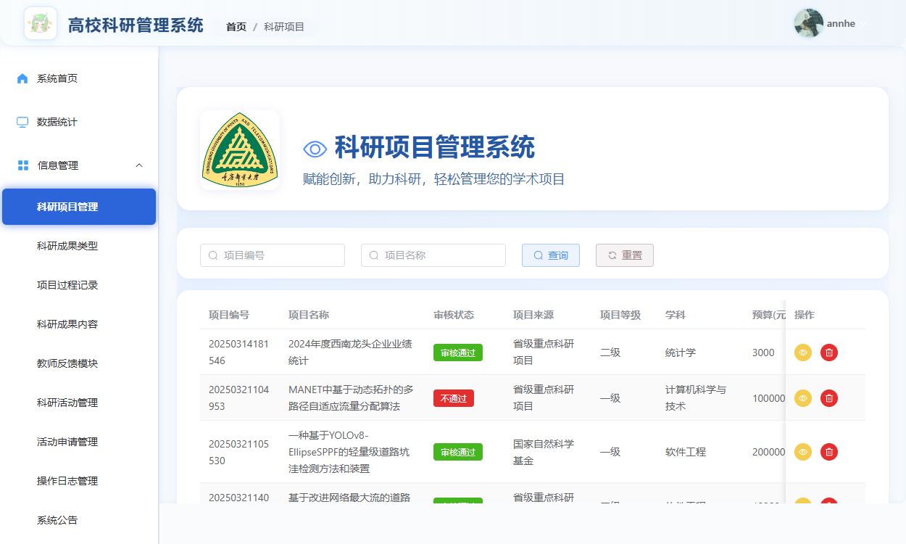
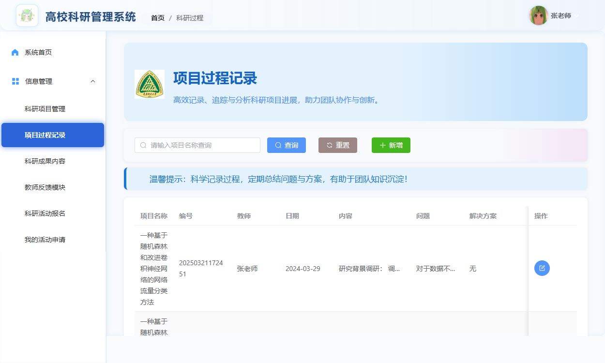
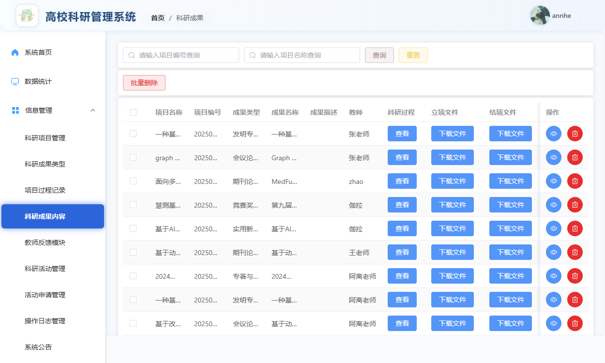
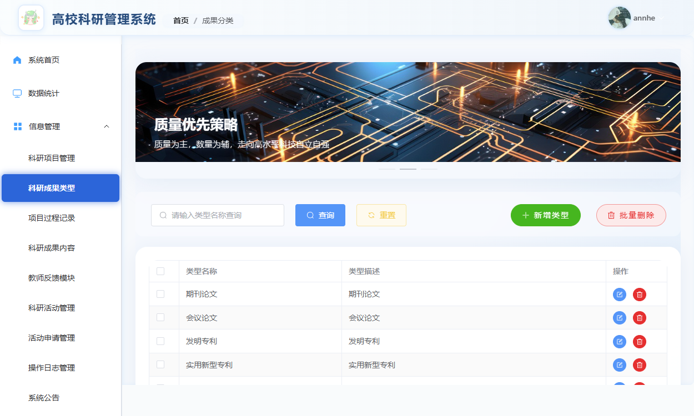
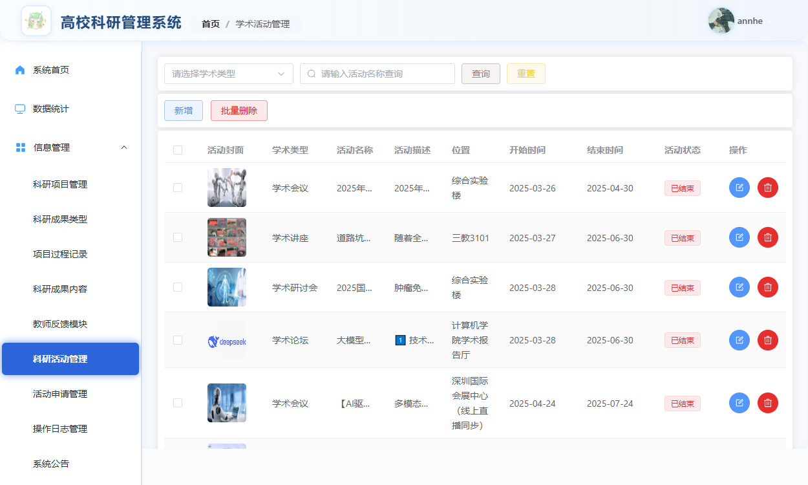
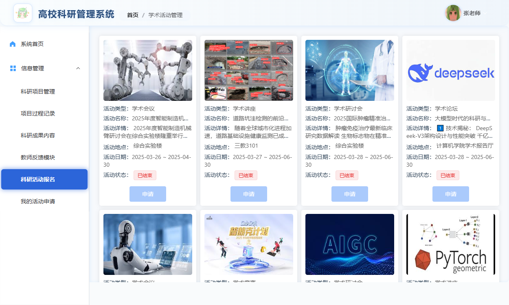
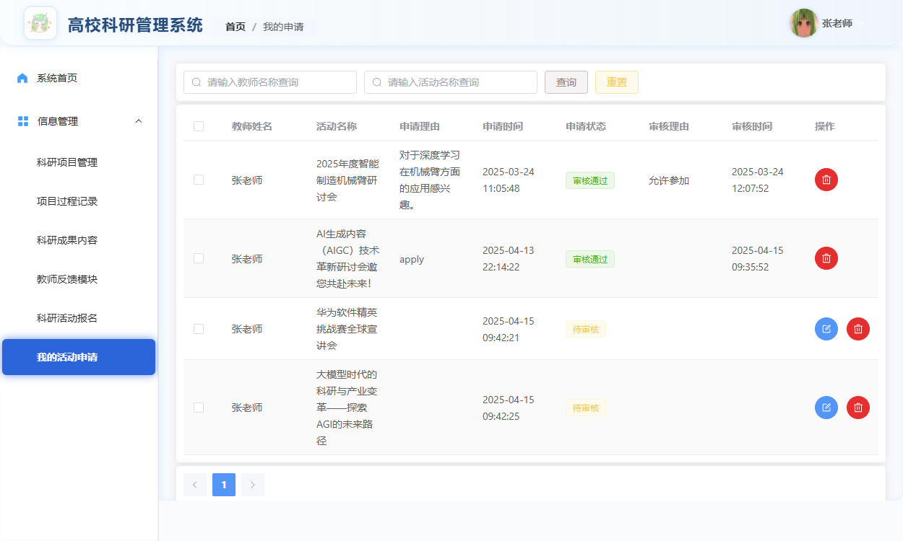
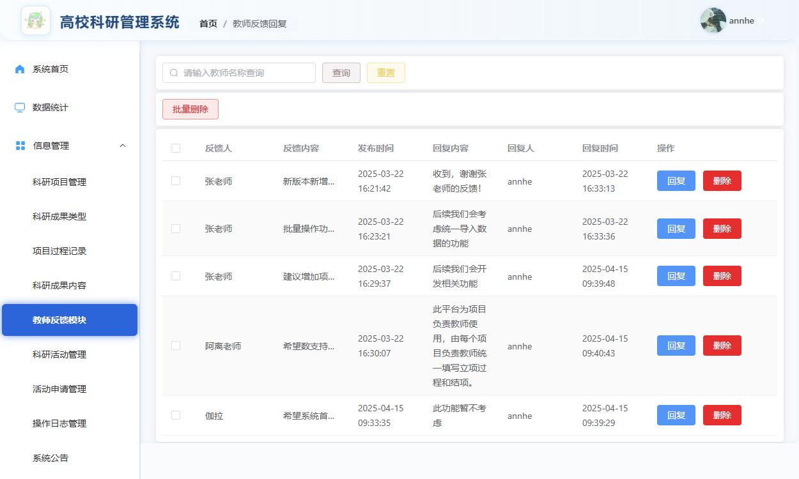
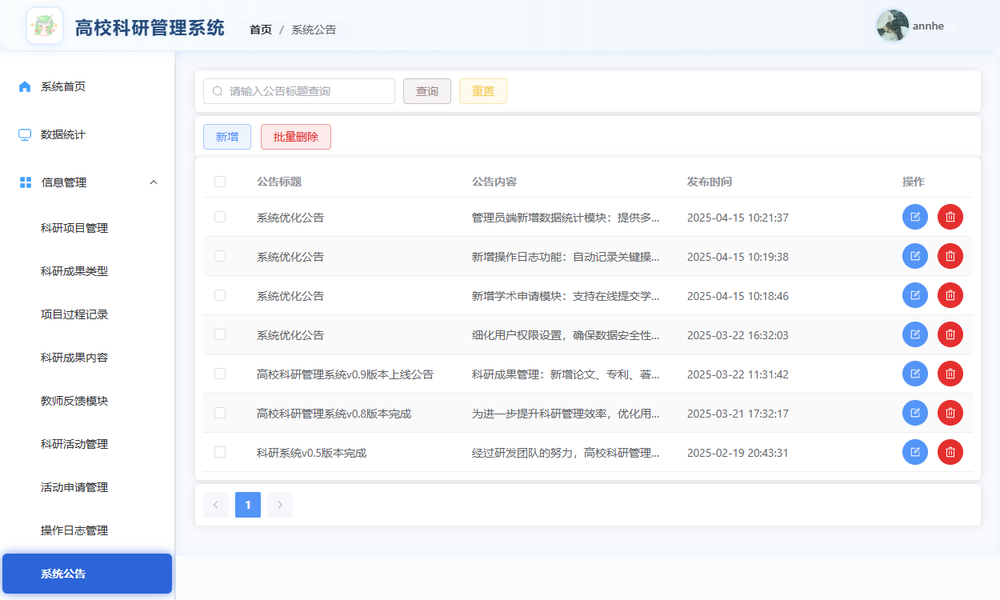

# 高校科研管理系统

这是我用 Vue 3 和 Spring Boot 做的一个高校科研管理系统。项目围绕教师的科研工作展开，把项目申报、过程记录、成果管理和学术活动放在同一个系统里，也提供了管理员审核、公告发布和数据统计等功能。

系统分为管理员端和教师端。教师可以提交科研项目、记录研究进展、整理成果、报名参加活动；管理员负责项目审核、信息维护、活动管理和反馈回复。

## 功能与界面

### 登录与注册

登录时可以选择管理员或教师身份，进入系统后显示对应的菜单。


### 系统首页

首页放了系统公告和科研资讯，登录后可以先了解近期通知，再进入具体的业务页面。


### 科研项目

项目管理记录了项目编号、名称、来源、等级、学科、预算和起止时间等信息。教师提交项目后，可以查看审核状态；管理员在同一个模块中查看和审核项目。



### 科研过程与时间线

除了项目本身，我也做了过程记录。教师可以把每个阶段的工作内容、遇到的问题和解决方案记下来，再按时间线查看，方便回顾整个研究过程。




### 科研成果

成果管理用于整理论文、专利等科研产出，成果类型可以单独维护，方便分类查看。





### 学术活动

系统支持学术会议、讲座、论坛、竞赛和研讨会等活动。管理员维护活动信息，教师报名后可以在“我的申请”中查看申请记录。







### 教师反馈

教师可以提交使用反馈和建议，管理员在后台查看并回复，保留每次反馈的处理记录。



### 系统公告

管理员发布和维护公告，教师可以在首页查看通知。



### 数据统计

统计页汇总了科研项目、成果、活动和教师数量。我用 ECharts 做了成果类型词云、项目等级雷达图、活动申请热力图和反馈趋势图，方便从整体上查看系统里的科研数据。


此外，系统还包括教师反馈与回复、管理员和教师信息管理、个人资料修改、密码修改、文件上传和操作日志。

## 技术实现

前端使用 Vue 3 和 Vite，页面组件主要用 Element Plus，路由由 Vue Router 管理，通过 Axios 请求后端接口，统计图表使用 ECharts。

后端使用 Java 17 和 Spring Boot 3.4.2，使用 MyBatis 操作 MySQL，PageHelper 处理分页，JWT 用于身份认证，Spring AOP 用于操作日志记录。

## 目录结构

```text
system/
├── vue/                       # 前端
│   └── src/views/             # 登录、注册和管理页面
├── springboot/                # 后端
│   ├── src/main/java/         # 接口、业务逻辑和数据访问
│   ├── src/main/resources/    # 配置文件和 MyBatis 映射
│   └── system.sql             # 数据库脚本
├── files/                     # 文件资源
└── docs/screenshots/          # 项目截图
```

## 本地运行

需要准备 Java 17、Maven、MySQL、Node.js 22 和 npm。

先创建 `system` 数据库，导入 `springboot/system.sql`，再修改 `springboot/src/main/resources/application.yaml` 中的数据库地址、用户名和密码。

启动后端：

```bash
cd springboot
mvn spring-boot:run
```

后端默认端口为 `9090`。文件接口从后端启动目录下的 `files/` 读取资源，运行时需要把项目中的文件资源放到对应目录。

另开一个终端启动前端：

```bash
cd vue
npm ci
npm run dev
```

打开终端中显示的本地地址即可。开发环境的接口地址配置在 `vue/.env.development` 中，默认为 `http://localhost:9090`。

## 打包部署

```bash
# 在 vue 目录执行
npm run build

# 在 springboot 目录执行
mvn clean package
```

部署前修改 `vue/.env.production` 中的接口地址，以及后端的数据库和 `fileBaseUrl` 配置。前端使用 History 路由，需要在 Web 服务器上配置回退到 `index.html`。
